# WEB SERVER

**SW-AI LAB · WEEK 13 · TEAM 11**

C와 POSIX 소켓 API만으로 구현한 HTTP 웹서버  
외부 HTTP 라이브러리 및 프레임워크 미사용

| PEAK THROUGHPUT | AVERAGE LATENCY | FUNCTIONAL TESTS |
| :---: | :---: | :---: |
| **92,750 req/s** | **0.09 ms** | **145 / 145** |
| 정적 파일 · 캐시 적용 | 동시 10연결 | 전체 통과 |

| UNIT CHECKS | MEMORY CHECK | MUTATION TESTS |
| :---: | :---: | :---: |
| **약 730** | **0 / 0** | **61 / 63** |
| 전체 통과 | 오류 / 누수 | 변이 검출 |

*측정 조건: WSL2 · 워커 8개 · 동시 10연결 · Keep-Alive · GET / 306바이트. 이하 수치는 원본 README의 보고값입니다.*

| HTTP | 동시성 | 정적·동적 콘텐츠 | 프록시 |
| :---: | :---: | :---: | :---: |
| HTTP/1.0 · 1.1 | Thread Pool | Static File · CGI | Reverse · Forward |
| GET · POST · HEAD | Keep-Alive | Thread-local Cache | Round-Robin · Failover |

[01 구조](#01-전체-구조) · [02 설계](#02-핵심-설계) · [03 성능](#03-성능-최적화) · [04 검증](#04-품질-검증) · [05 회고](#05-회고) · [상세 문서](#상세-문서)

---

## 01. 전체 구조

> 메인 스레드는 연결 수락만 담당하고, 워커가 HTTP 요청을 처리합니다. 요청 유형에 따라 네 가지 처리 경로를 선택합니다.

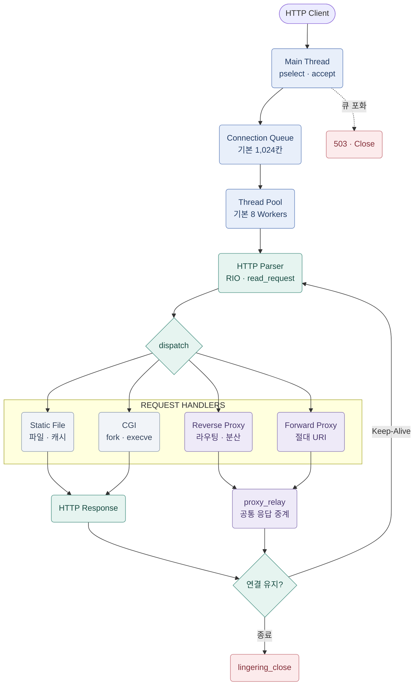

| 연결 관리 | HTTP 처리 | 콘텐츠 처리 | 프록시 처리 |
| :--- | :--- | :--- | :--- |
| `main.c` · `net.c` | `http_request.c` | `static_file.c` · `mime.c` | `router.c` · `proxy.c` |
| `server.c` · `threadpool.c` | `rio.c` · `http_response.c` | `cgi.c` | `forward_proxy.c` |

---

## 02. 핵심 설계

### 2-1. Thread Pool

*연결이 몰려도 서버가 멈추지 않도록*

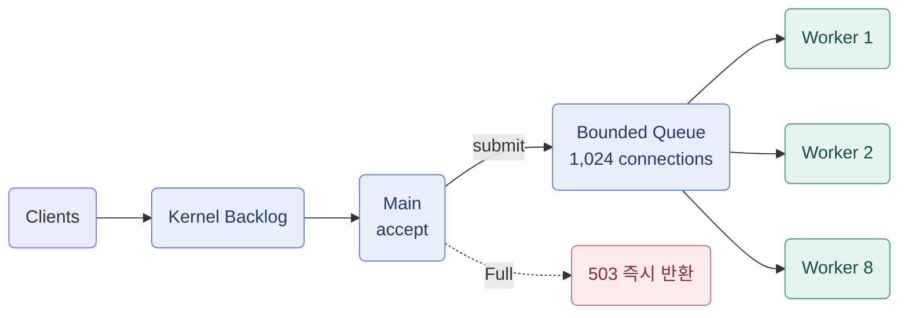

| 반복 서버 | 연결마다 스레드 | **Thread Pool (채택)** |
| :---: | :---: | :---: |
| 한 연결이 다음 연결을 막음 | 연결 증가 → 스레드 증가 | 워커 수 고정 + 유한 큐 |
| 동시 처리 어려움 | 생성 비용 · 자원 고갈 | 재사용 · 과부하 제어 |

- 메인: `socket → bind → listen → pselect → accept`. 워커는 작업이 없으면 `pthread_cond_wait`로 대기합니다.
- 워커 8개(`-t`), 사용자 공간 큐 1,024칸(`-q`)은 기본값입니다. 커널 backlog와 별개의 큐입니다.
- 큐 포화 시 메인 스레드를 막지 않고 503을 반환합니다. fd 고갈 시 100ms 대기로 busy loop를 방지합니다.


### 2-2. HTTP 처리

*하나의 연결로 여러 요청, 오류는 일관되게*

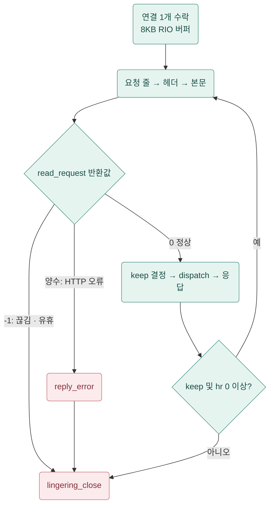

| 수신 유휴 | 송신 제한 | 요청 전체 마감² | 요청 크기 상한 |
| :---: | :---: | :---: | :---: |
| **5초** | **10초** | **10초** | 본문 **1MB** |

² 원본 설명 기준 요청 줄 수신 후부터 적용. 송신 10초는 소켓 송신 타임아웃이며 응답 전송 전체의 절대 마감은 아닙니다.

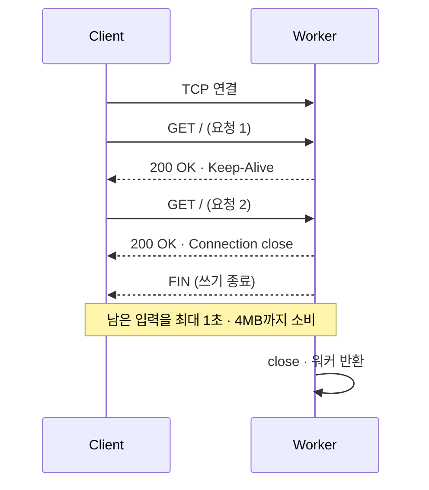

**부하 대응:** 큐에 대기자가 있으면 응답 후 연결을 유지하지 않도록 결정해 다음 클라이언트에 워커를 양보합니다. 연결을 닫을 때는 남은 입력을 읽어 RST로 응답이 유실될 위험을 줄입니다.


### 2-3. 요청 분기와 정적 파일

*자주 쓰는 경로를 빠르게*

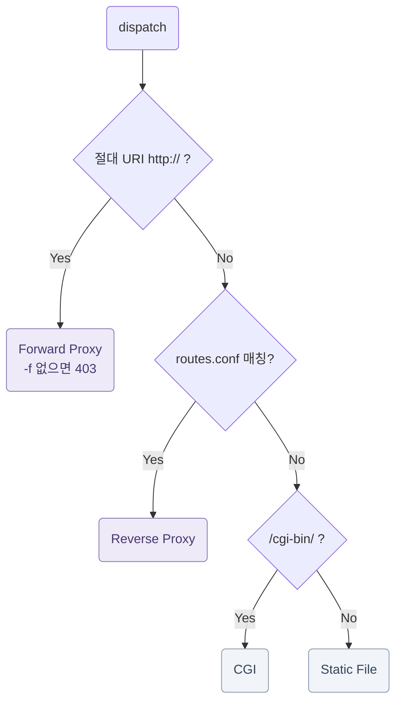

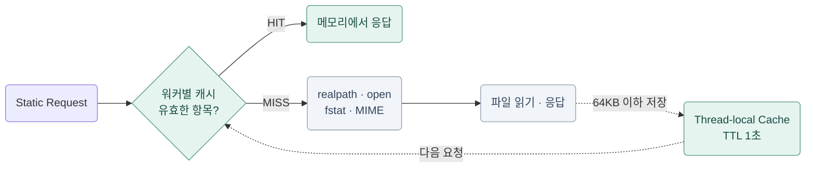

| 캐시 크기 상한(파일당) | 캐시 유효 시간 | 동기화 방식 |
| :---: | :---: | :---: |
| **64KB** | **1초** | **워커별 캐시 · 공유 락 없음** |

캐시 미스에서는 실제 경로 및 루트 범위를 확인하고 일반 파일만 제공합니다. 캐시 히트는 반복되는 파일 접근 비용을 줄입니다. 파일 수정 후 최대 1초 동안 이전 내용이 제공될 수 있습니다.


### 2-4. CGI

*별도 프로세스 실행, 파이프 교착 방지*

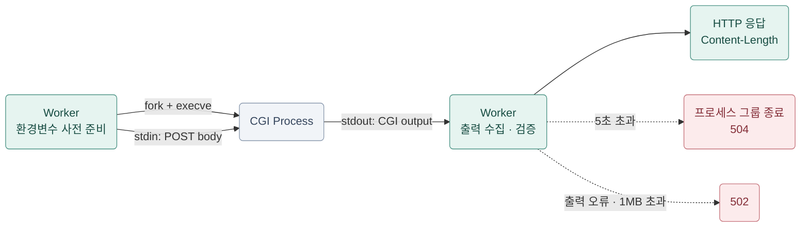

| 순차 파이프 I/O (문제) | `poll` 기반 동시 I/O (해결) |
| :---: | :---: |
| 쓰기 완료를 기다리면서 출력 파이프를 읽지 않음 | stdin 쓰기와 stdout 읽기를 함께 진행 |
| 양쪽 버퍼가 차면 교착 가능 | 512KB POST 에코 테스트에서 교착 없음 |

환경변수는 `fork` 전에 구성하고 자식은 `execve` 전 async-signal-safe 작업으로 제한합니다. CGI 출력은 서버가 검증한 뒤 응답하며, 시간 초과 시 프로세스 그룹 전체를 종료하고 `waitpid`로 회수합니다.


### 2-5. Reverse / Forward Proxy

*서로 다른 입구, 하나의 중계 엔진*

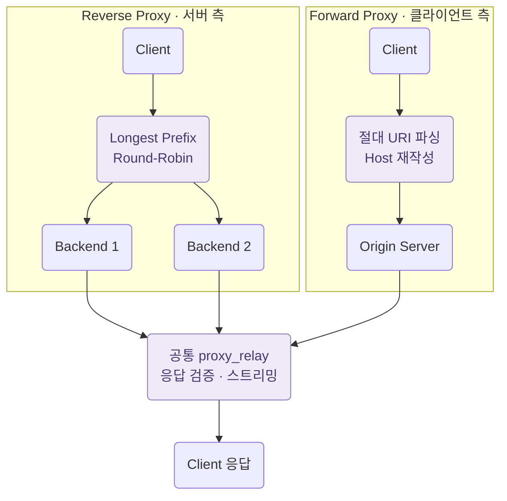

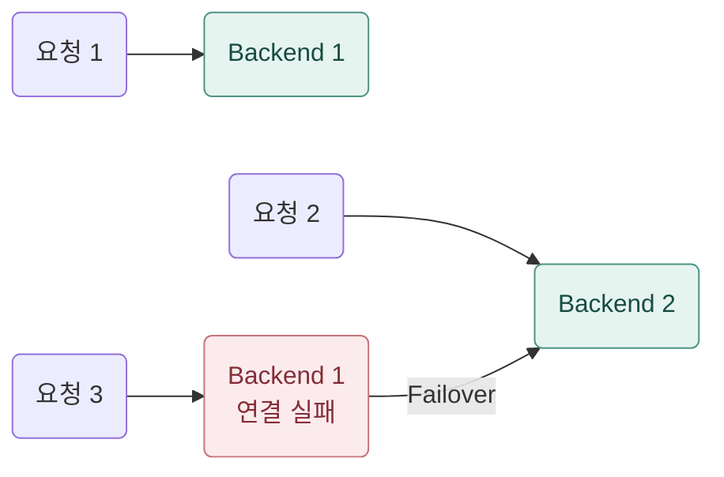

| 기능 | 설계 |
| :--- | :--- |
| Reverse | 최장 prefix 일치 → 원자적 Round-Robin 카운터 → 연결 실패 백엔드 건너뛰기 |
| Forward | `http://host:port/path` 파싱 → Host 재작성 → 원 서버에 경로만 전송 (`-f` 필요) |
| 공통 중계 | hop-by-hop 헤더 제거, 백엔드 `Connection: close`, 응답 헤더 검증, 본문 스트리밍 |
| 장애 대응 | 모든 백엔드 연결 실패/잘못된 응답 **502** · connect/응답 헤더 마감 초과 **504** |

Forward Proxy는 HTTP만 지원합니다. HTTPS CONNECT, TLS, 백엔드 연결 재사용은 구현 범위에 포함되지 않습니다.

---

## 03. 성능 최적화

### 3-1. 측정 → 병목 분석 → 개선

| 첫 번째 병목 | 두 번째 병목 | 세 번째 병목 |
| :--- | :--- | :--- |
| 작은 응답 약 40ms 지연 | 동시 100·500연결에서 503 약 89% | 정적 파일 약 3,000 req/s 정체 |
| Nagle + Delayed ACK | Keep-Alive가 워커 점유 | WSL `/mnt/c` 파일 시스템 호출 |
| `TCP_NODELAY` | 워커 양보 + 큐 1,024 | 워커별 작은 파일 캐시 |
| **173 → 3,058 req/s** | **503 약 89% → 0건** | **3,120 → 92,750 req/s** |

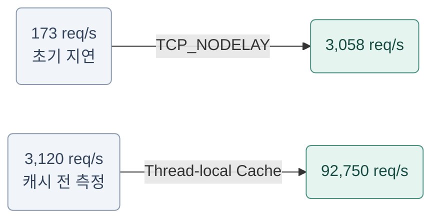

*각 행은 원본 README의 별도 전후 측정이며 하나의 동일 실험에서 연속 측정한 시계열은 아닙니다.*


### 3-2. 부하 테스트

*캐시 적용 전후*

**정적 파일 처리량 (req/s)** · 전체 막대는 동일 척도

| 동시 연결 | 캐시 전 | 캐시 후 | 개선 배수 |
| :---: | :--- | :--- | :---: |
| **10** | `▋` 3,120 | `████████████████████` **92,750** | **29.7×** |
| **100** | `▋` 3,211 | `████████▉` **41,368** | **12.9×** |
| **500** | `▋` 3,166 | `████████` **37,024** | **11.7×** |

*막대 1칸 ≈ 4,638 req/s. 소수 칸은 근사 표시.*

| 동시 10연결 평균 응답 지연 | 동시 500연결 정적 파일 | 보고된 부하 테스트 오류 |
| :---: | :---: | :---: |
| **0.09ms** | **37,024 req/s** | **503 0 · 소켓 오류 0** |

*측정 환경: WSL2 · 워커 8개 · wrk 10초 · Keep-Alive · 정적 파일 GET / 306바이트.*

### CGI / Reverse Proxy 추가 측정 (동시 100연결)

| 대상 | 처리량 |
| :--- | ---: |
| 정적 파일 (캐시 후) | 41,368 req/s |
| Reverse Proxy (백엔드 2개) | 약 16,800 req/s |
| CGI `adder` | 약 1,250 req/s |

각 요청의 처리 내용이 달라 성능 수치는 기능별 참고값이며 동일 작업의 성능 순위가 아닙니다.


---

## 04. 품질 검증

### 4-1. 테스트 결과

*기능뿐 아니라 실패 상황과 테스트 자체까지*

| Functional | Unit | Sanitizer / Valgrind | Mutation |
| :---: | :---: | :---: | :---: |
| **145 / 145** | **약 730** | **0 오류 · 0 누수** | **61 / 63** |
| 정상 · ASan 빌드 | 11개 테스트 파일 | 실제 서버 시나리오 | 나머지 2개 등가 변이로 보고 |

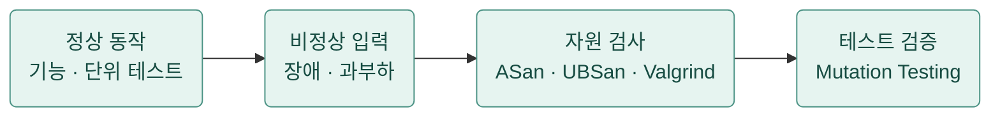


### 4-2. 실제로 깨뜨려 본 시나리오

| 공격·장애·경계 조건 | 서버 방어 | 검증 결과 |
| :--- | :--- | :--- |
| Slowloris · 요청 중단 | 요청 마감 | **408** |
| 경로 탈출 · 루트 밖 심볼릭 링크 | 실제 경로 검사 | **403**, 내용 노출 없음 |
| CGI 512KB 입력 / 출력 | `poll` 동시 I/O | 교착 없음 |
| CGI 시간 초과 | 프로세스 그룹 종료 | **504**, 자식까지 종료 |
| 잘못된 백엔드 응답 17종 | 공통 헤더 검증 | **502** |
| 응답하지 않는 백엔드 | 헤더 마감 | **504** |
| 워커·큐 포화 | 즉시 거부 | **503** |
| SIGINT / SIGTERM | Graceful Shutdown | 시험에서 1초 이내 `exit 0` |


### 4-3. Mutation Testing

*테스트도 검증 대상*

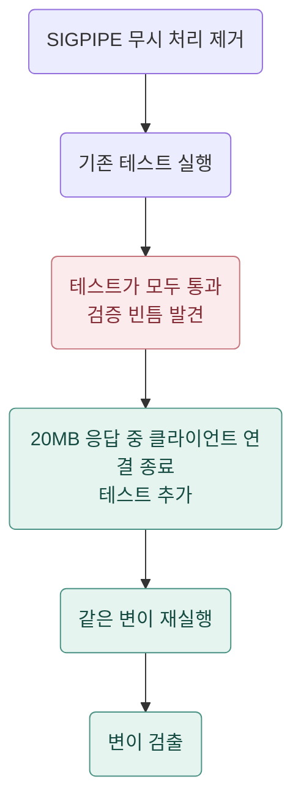

AI 교차 리뷰 역시 지적을 그대로 반영하지 않고 재현 또는 코드 확인을 거친 후 채택·기각했습니다.

---

## 05. 회고

### 구현한 기능과 실제로 필요한 기능은 다르다

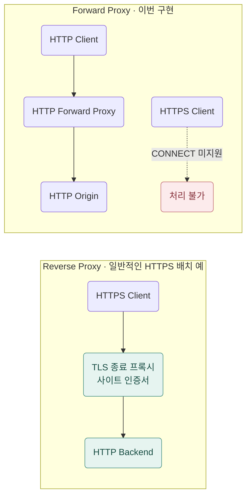

| Reverse Proxy | Forward Proxy |
| :--- | :--- |
| 이번 구현의 라우팅·분산·장애 우회는 HTTP 환경에서 실용적 | 이번 구현은 HTTP만 처리하므로 HTTPS 중심 웹에서 활용 범위가 제한적 |
| 실제 배포에서 별도 TLS 종료 프록시와 조합 가능 | HTTPS를 중계하려면 CONNECT 터널링 등이 필요 |

위 HTTPS Reverse 구성은 일반적인 배포 예시이며, **이 프로젝트 자체에는 TLS 종료 기능이 없습니다.**

> **배운 점**
>
> 기능 수보다 사용 목적을 먼저 정의하고, 성능은 계측으로, 안정성은 재현 가능한 실패 테스트로 검증하는 것이 중요합니다.

---

## 상세 문서

### 빌드 · 실행 · 데모 명령

WSL2(Ubuntu) / Linux. 기능 테스트는 `/proc`와 `ss` 사용으로 Linux/WSL 전용입니다.

```bash
make
make test
make asan
bash tests/functional.sh
SERVER=build/asan/server bash tests/functional.sh
bash tests/load.sh
```

```bash
./bin/server -p 8080 -r ./www
./bin/server -p 8080 -r ./www -c conf/routes.conf
./bin/server -p 8080 -r ./www -f
```

```bash
curl http://127.0.0.1:8080/
curl 'http://127.0.0.1:8080/cgi-bin/adder?a=1&b=2'
curl -d 'a=40&b=2' http://127.0.0.1:8080/cgi-bin/adder
curl http://127.0.0.1:8080/api/index.html
curl -x 127.0.0.1:8080 http://127.0.0.1:8001/index.html
```

| 옵션 | 기본값 | 의미 |
| :--- | :--- | :--- |
| `-p` | 8080 | 포트 |
| `-r` | `./www` | 정적 파일 루트 |
| `-g` | `./cgi-bin` | CGI 폴더 |
| `-c` | 없음 | Reverse 라우팅 설정 |
| `-f` | 꺼짐 | Forward Proxy 허용 |
| `-t` | 8 | 워커 수 |
| `-q` | 1024 | 연결 대기 큐 |


### 구현 모듈 · 세부 검증

| Part | 파일 | 세부 구현 및 검증 |
| :--- | :--- | :--- |
| 1. 연결 수락 | `main.c`, `server.c`, `net.c`, `threadpool.c` | 잘못된 인자 30종 거부, 유효한 값 8종, 포트 충돌 및 재시작, `pselect` 시그널 마스크, fd 한도 CPU 0~1%, 스레드풀 20회 반복 |
| 2. HTTP 파싱 | `http_request.c`, `rio.c` | short count, EINTR, Host 중복, Transfer-Encoding 요청 거부, 헤더 제어 문자 차단, 20KB 헤더 431, 3MB 본문 413, SIGPIPE 방어 |
| 3. 정적 파일 | `static_file.c`, `mime.c`, `http_response.c` | 경로 검사, `open` 후 동일 fd `fstat`, FIFO non-blocking, MIME 20종, 64KB 캐시 경계, TTL 및 루트 분리, 파일 바이트 일치 |
| 4. CGI | `cgi.c`, `cgi-bin/adder.c` | 환경변수, 512KB POST, 출력 1MB 경계, 5초 초과, 프로세스 그룹 종료, fd·좀비 검사, CLOEXEC, 시그널 복구 |
| 5. 프록시 | `router.c`, `proxy.c`, `forward_proxy.c` | hop-by-hop 제거, Host, 300KB POST, 비정상 응답 17종, connect·헤더 5초, 8스레드 80만 Round-Robin 균등 분배, failover, URI 파싱 |
| 6. 연결 종료 | `server.c`, `main.c` | 정적·CGI·Reverse·Forward Keep-Alive, 과부하 워커 양보, lingering close, graceful shutdown, fd 변화 없음 |

반환 규칙: `0` 성공, 양수는 HTTP 오류 상태 코드, `-1`은 연결 종료. 요청 파싱 오류는 응답 후 연결을 닫고, 정상 파싱 후 핸들러 오류는 keep 조건에 따라 연결을 유지할 수 있습니다.


### 설계 결정 · 현재 한계

| 항목 | 현재 범위 |
| :--- | :--- |
| 프로토콜 | HTTP/1.0·1.1, GET·POST·HEAD; TLS 및 요청 chunked 미지원 |
| 동시성 | 고정 크기 스레드 풀; 워커 변경은 재시작 필요 |
| 요청 제한 | URI 2KB, 헤더 줄 8KB, 헤더 32개, 본문 1MB |
| Forward | HTTP만 지원; CONNECT, DNS 조회 시간 제한, 접속 대상 제한 없음. 신뢰 환경에서만 `-f` 사용 |
| Reverse | 백엔드 연결 재사용, 1xx 응답, X-Forwarded-For 미지원 |
| 정적 파일 | 64KB 이하 파일 캐시, TTL 1초로 인해 일시적으로 오래된 내용 반환 가능 |
| 응답 시간 | 전체 응답 전송 마감 없음. 조금씩 읽는 느린 클라이언트가 워커를 오래 점유할 수 있음 |

선택한 모델은 연결당 워커 방식의 스레드 풀입니다. 대규모 장시간 연결을 목표로 한다면 이벤트 기반 구조 등 다른 동시성 모델을 검토해야 합니다.


### 전체 검증 · AI 교차 리뷰 · 협업 규칙

- `-Wall -Wextra -Werror` 경고 0, ASan/UBSan 단위 및 기능 테스트 통과, Valgrind 오류/누수 0으로 보고.
- 변이 63개 중 61개 검출. 원본은 나머지 2개를 등가 변이(`pselect` EINTR 처리, CGI 입력 파이프 종료 시점)로 분류.
- AI 리뷰 채택: 헤더 값 CR 차단, failover 시작 인덱스 고정, DNS 오류 errno 명시.
- AI 리뷰 기각: CGI 폴더 심볼릭 링크는 신뢰된 관리자가 배치한다는 설계 전제, Forward 자기 자신 대상 요청은 경로만 재전송하므로 프록시 재귀가 발생하지 않는다는 검증 결과.
- 팀 협업: 개인 fork 구현, 원본 `dev` PR, 승인 1명 이상 및 Squash and merge, 빌드/테스트/ASan 통과 및 신규 기능 테스트.


원본: [feat/kimgeonhui-core README](https://github.com/kimgeonhui1/SW-AI-W13-WEB-SERVER/blob/feat/kimgeonhui-core/README.md) (`8e3adb8c` README blob). 발표용 재구성본이며, 수치와 검증 결과는 원본 보고값을 옮겼고 별도 실행으로 재검증하지 않았습니다.
